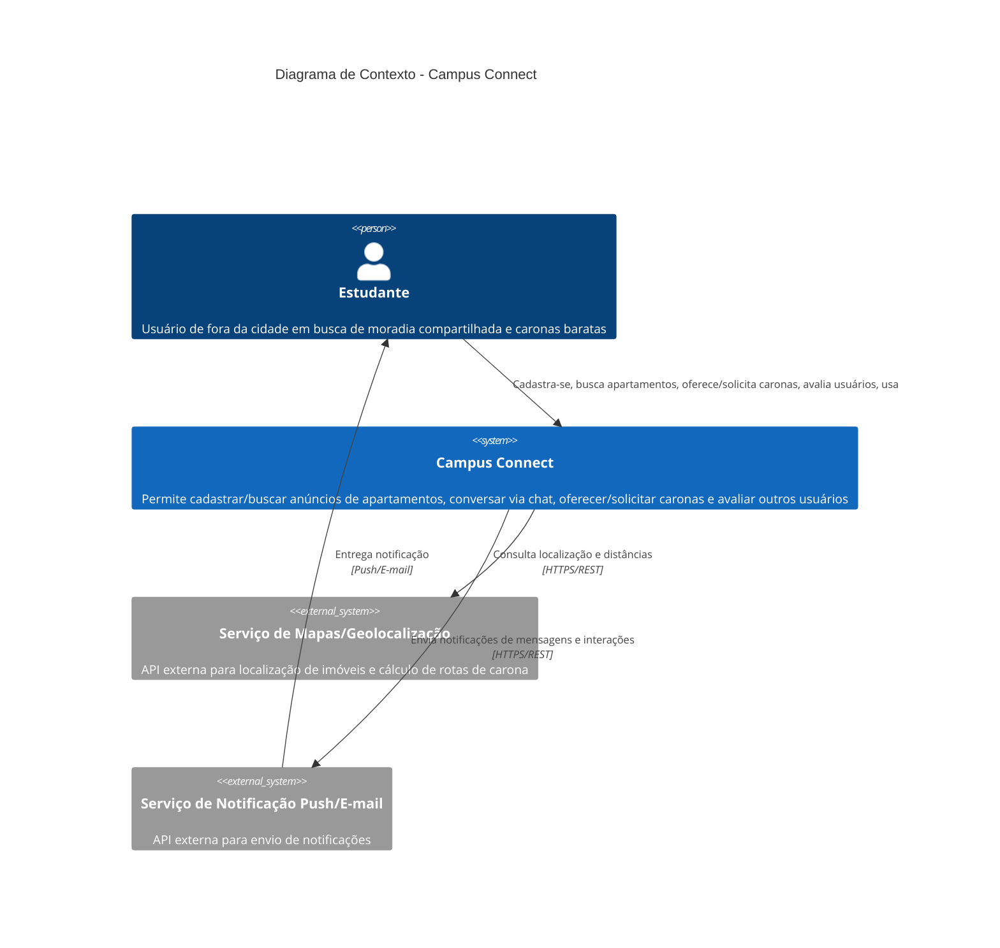
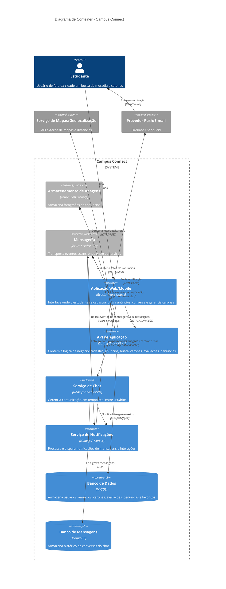
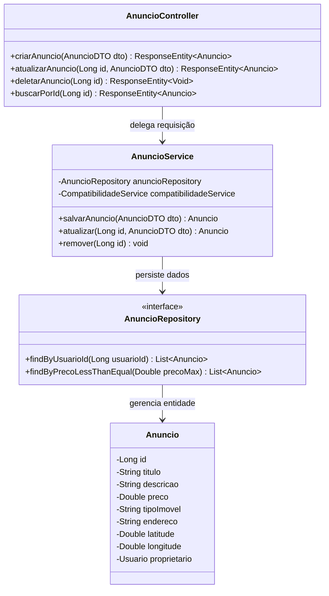
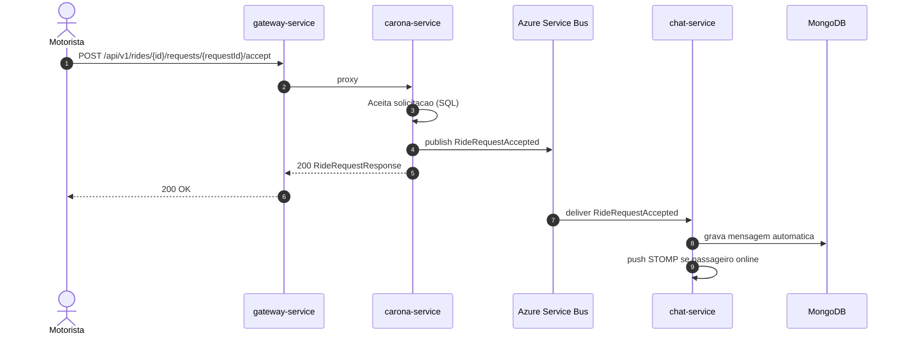
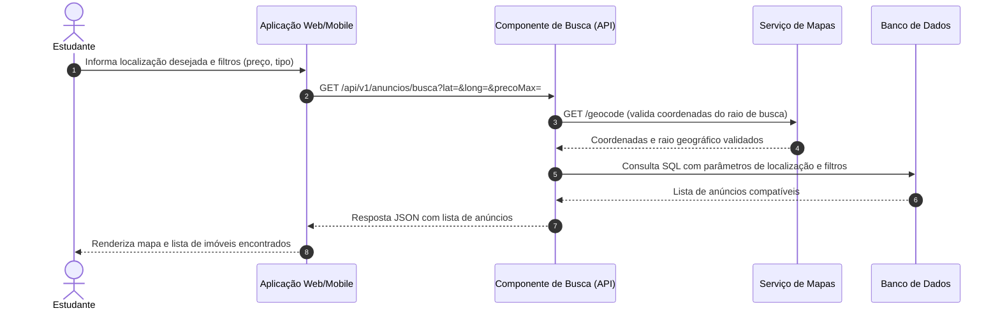
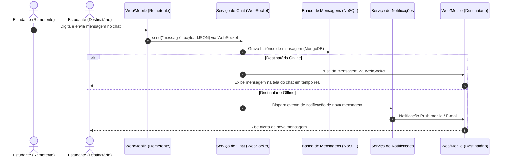
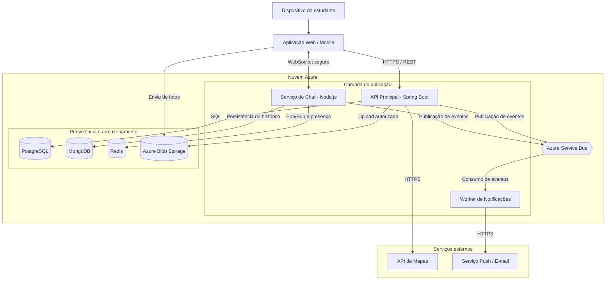
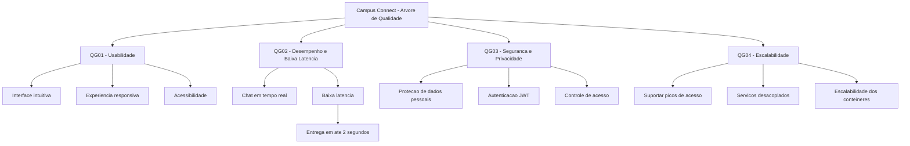

# Documentação de Arquitetura de Software

## Campus Connect \- Sistema de Compartilhamento de Moradia Estudantil e Caronas

## Nome dos integrantes: André Gabriel Benato, Arthur Markowicz Lopes, Gustavo Tissot França e Luigi Morgenstern Milani

## 1\. Introdução e Objetivos

O Campus Connect é uma plataforma desenvolvida para resolver os desafios enfrentados por estudantes universitários ao se mudarem para novas cidades. O foco principal é facilitar a busca por moradia compartilhada e conectar estudantes para o compartilhamento de caronas, reduzindo custos por parte do universitário.

### 1.1 Visão Geral do Sistema e Requisitos Funcionais

O Campus Connect abrange desde o cadastro e autenticação de estudantes até o gerenciamento completo de anúncios de apartamentos, busca geolocalizada, comunicação em tempo real, oferta/solicitação de caronas, sistema de reputação/avaliação, sugestão de compatibilidade e denúncias.

Os requisitos funcionais incluem:

1. O sistema deve permitir o cadastro de estudantes.  
2. O sistema deve permitir login e autenticação de usuários.  
3. O sistema deve permitir que usuários criem anúncios de apartamentos.  
4. O sistema deve permitir editar e excluir anúncios de moradia.  
5. O sistema deve permitir a busca de apartamentos por localização.  
6. O sistema deve permitir filtrar anúncios por preço, localização e tipo de imóvel.  
7. O sistema deve permitir que usuários adicionem anúncios aos favoritos.  
8. O sistema deve permitir comunicação via chat entre usuários.  
9. O sistema deve permitir que usuários ofereçam caronas.  
10. O sistema deve permitir que usuários solicitem caronas.  
11. O sistema deve permitir avaliar outros usuários após interação.  
12. O sistema deve exibir a reputação dos usuários.  
13. O sistema deve sugerir possíveis compatibilidades entre moradores.  
14. O sistema deve enviar notificações sobre mensagens e interações.  
15. O sistema deve permitir denunciar usuários ou anúncios suspeitos.

### 1.2 Objetivos de Qualidade

| ID | Meta de Qualidade | Descrição |
| :---- | :---- | :---- |
| **QG01** | **Usabilidade** | A interface web/mobile deve ser intuitiva, fluida e acessível para facilitar o uso por estudantes de diversos perfis. |
| **QG02** | **Desempenho & Baixa Latência** | As mensagens do chat devem ser entregues em até 2 segundos em condições normais de operação. |
| **QG03** | **Segurança & Privacidade** | Proteção de dados sensíveis dos estudantes e autenticação robusta. |
| **QG04** | **Escalabilidade** | A arquitetura orientada a contêineres e serviços deve suportar picos de acessos no início de períodos letivos universitários. |

### 1.3 Stakeholders

| Papel / Stakeholder | Expectativa |
| :---- | :---- |
| **Estudantes Universitários** | Encontrar moradia barata, colegas compatíveis e caronas acessíveis de forma rápida e segura. |
| **Equipe de Desenvolvimento** | Manter uma arquitetura modular, limpa e de fácil manutenção e evolução. |

## 2\. Restrições da Arquitetura

As restrições de arquitetura definem as limitações organizacionais, operacionais, econômicas e regulatórias sob as quais o sistema deve ser projetado e construído, impondo fronteiras que a equipe deve obrigatoriamente respeitar.

### 2.1 Restrições de Negócio, Equipe e Infraestrutura

* **Restrição de Infraestrutura e Custo Zero:** Todo o desenvolvimento e implantação devem utilizar exclusivamente ferramentas gratuitas, camadas de uso gratuito de serviços em nuvem ou infraestrutura própria dos integrantes da equipe, sem orçamento disponível para aquisição de licenças ou hardware dedicado.  
* **Restrição de Prazo Acadêmico:** O sistema e suas entregas de documentação/código estão estritamente vinculados ao calendário acadêmico da disciplina, exigindo validações e marcos funcionais em datas pré-definidas.  
* **Conformidade de Privacidade (LGPD):** O armazenamento e tratamento dos dados de cadastro e localização dos estudantes devem respeitar as diretrizes da Lei Geral de Proteção de Dados (LGPD), garantindo a proteção e o consentimento do uso de informações pessoais e acadêmicas.

## 3\. Contexto e Escopo

O escopo do sistema delimita as responsabilidades do Campus Connect e suas interações com os atores externos e serviços terceirizados, como mapas, geolocalização e envio de notificações.

### 3.1 Contexto de Negócio e Técnico

O estudante interage diretamente com o Campus Connect cadastra-se, busca moradia, gerencia caronas, conversa com usuários e realiza avaliações. O sistema consome serviços externos para resolver coordenadas geográficas e enviar notificações aos dispositivos dos usuários.

### 3.2 Diagrama de Contexto (C4 Model Level 1\)

&nbsp;

## 4\. Estratégia da Solução

A estratégia da solução define as decisões fundamentais de arquitetura que garantem o cumprimento dos objetivos de qualidade e requisitos do Campus Connect:

1. **Arquitetura Baseada em Contêineres / Microserviços Leves:**

   * **Aplicação Web/Mobile:** Proporciona uma experiência responsiva e única tanto em desktops quanto em celulares.  
   * **API de Aplicação:** Concentra a lógica de negócio principal, sendo os anúncios, caronas, avaliações, algoritmo de compatibilidade e denúncias, utilizando o ecossistema robusto e seguro do Spring.  
   * **Serviço de Chat Dedicado:** Isola a carga de conexões persistentes mantidas durante conversas em tempo real, evitando sobrecarga na API de negócios.  
   * **Serviço de Notificações:** Processa de forma assíncrona o disparo de notificações via filas ou chamadas HTTP para não bloquear a experiência do usuário.  
2. **Estratégia de Persistência Poliglota:**

   * **Banco de Dados Relacional:** Utilizado pela API Principal para garantir consistência ACID nos cadastros, anúncios, transações de carona, avaliações e denúncias.  
   * **Banco de Dados NoSQL:** Utilizado pelo Serviço de Chat para alto desempenho de gravação/leitura de histórico de mensagens e gerenciamento de estados de presença.  
3. **Integração Externa Padronizada:**

   * Utilização de padrões RESTful com JSON trafegado sobre HTTPS para chamadas à API externa de mapas/rotas e aos serviços de Notificação Push/E-mail.

### 4.1 Diagrama de Contêineres (C4 Model Level 2\)

&nbsp;

## 5\. Visão dos Blocos de Construção

A Visão dos Blocos de Construção decompõe a estrutura estática do sistema em componentes funcionais, mapeando a rastreabilidade direta com os requisitos funcionais.

### 5.1 Nível 1 e 2: Decomposição Geral

A decomposição de alto nível está representada pelos diagramas C4 de Contexto (Nível 1 na Seção 3.2) e Contêineres (Nível 2 na Seção 4.1).

### 5.2 Nível 3: Componentes da API de Aplicação (C4 Model Level 3\)

A API de Aplicação é o contêiner central responsável pela lógica de negócio do Campus Connect. Seus componentes são organizados de acordo com as principais funcionalidades do sistema, permitindo a separação das responsabilidades e a rastreabilidade com os requisitos funcionais.

```mermaid
C4Component
    title Diagrama de Componentes - API de Aplicação (Campus Connect)
    Container_Ext(blobStorage, "Armazenamento de Imagens","Azure Blob Storage", "Armazena fotos dos anúncios")
    Container_Ext(serviceBus, "Mensageria","Azure Service Bus", "Gerencia filas e eventos assíncronos")
    Container(webApp, "Aplicação Web/Mobile", "React / React Native", "Interface do estudante")
    ContainerDb(database, "Banco de Dados", "MySQL", "Dados persistentes do sistema")
    Container(notificationService, "Serviço de Notificações", "Node.js / Worker", "Dispara notificações")
    System_Ext(sistemaMapas, "Serviço de Mapas/Geolocalização", "API externa de mapas")

    Container_Boundary(apiApp, "API de Aplicação") {
        Component(authComponent, "Componente de Autenticação", "Spring Security / JWT", "Responsável pelo cadastro, login e autenticação de usuários (RF01 e RF02)")
        Component(anuncioComponent, "Componente de Anúncios", "Spring Boot", "Gerencia criação, edição, exclusão e listagem de anúncios (RF03 e RF04)")
        Component(buscaComponent, "Componente de Busca e Filtros", "Spring Boot", "Realiza busca por localização e filtros de preço e tipo de imóvel (RF05 e RF06)")
        Component(favoritoComponent, "Componente de Favoritos", "Spring Boot", "Gerencia os anúncios favoritados pelos usuários (RF07)")
        Component(chatComponent, "Componente de Integração com Chat", "Spring Boot", "Integra a API principal ao serviço de comunicação em tempo real (RF08)")
        Component(caronaComponent, "Componente de Caronas", "Spring Boot", "Gerencia ofertas e solicitações de caronas (RF09 e RF10)")
        Component(avaliacaoComponent, "Componente de Avaliação e Reputação", "Spring Boot", "Processa avaliações e gerencia a reputação dos usuários (RF11 e RF12)")
        Component(compatibilidadeComponent, "Componente de Compatibilidade", "Spring Boot", "Processa dados dos usuários e sugere possíveis compatibilidades entre moradores (RF13)")
        Component(notificacaoComponent, "Componente de Notificações", "Spring Boot", "Gerencia eventos que devem gerar notificações para os usuários (RF14)")
        Component(denunciaComponent, "Componente de Denúncias", "Spring Boot", "Gerencia denúncias de usuários e anúncios suspeitos (RF15)")
    }

    Rel(webApp, authComponent, "Realiza cadastro e login", "HTTPS/JSON")
    Rel(webApp, anuncioComponent, "Gerencia anúncios", "HTTPS/JSON")
    Rel(webApp, buscaComponent, "Busca e filtra anúncios", "HTTPS/JSON")
    Rel(webApp, favoritoComponent, "Gerencia favoritos", "HTTPS/JSON")
    Rel(webApp, chatComponent, "Inicia e gerencia comunicação", "HTTPS/JSON")
    Rel(webApp, caronaComponent, "Oferece e solicita caronas", "HTTPS/JSON")
    Rel(webApp, avaliacaoComponent, "Realiza avaliações", "HTTPS/JSON")
    Rel(webApp, denunciaComponent, "Registra denúncias", "HTTPS/JSON")

    Rel(buscaComponent, sistemaMapas, "Consulta localização e distâncias", "HTTPS/REST")
    Rel(caronaComponent, sistemaMapas, "Consulta rotas e distâncias", "HTTPS/REST")

    Rel(anuncioComponent, compatibilidadeComponent, "Aciona sugestão de compatibilidade", "Chamada interna")
    Rel(chatComponent, notificacaoComponent, "Aciona notificação de nova mensagem", "Chamada interna")
    Rel(caronaComponent, notificacaoComponent, "Aciona notificação de interação", "Chamada interna")
    Rel(avaliacaoComponent, notificacaoComponent, "Aciona notificação de avaliação", "Chamada interna")

    Rel(notificacaoComponent, serviceBus, "Publica eventos de notificação", "Azure Service Bus")
    Rel(serviceBus, notificationService, "Entrega eventos ao Worker", "Fila / Mensageria")
    Rel(anuncioComponent, blobStorage, "Armazena fotos dos anúncios e obtém suas URLs", "HTTPS/REST")
    Rel(authComponent, database, "Lê e grava usuários", "SQL")
    Rel(anuncioComponent, database, "Lê e grava anúncios", "SQL")
    Rel(buscaComponent, database, "Consulta anúncios", "SQL")
    Rel(favoritoComponent, database, "Lê e grava favoritos", "SQL")
    Rel(caronaComponent, database, "Lê e grava caronas", "SQL")
    Rel(avaliacaoComponent, database, "Lê e grava avaliações", "SQL")
    Rel(compatibilidadeComponent, database, "Consulta perfis dos usuários", "SQL")
    Rel(denunciaComponent, database, "Grava denúncias", "SQL")

    UpdateLayoutConfig($c4ShapeInRow="4", $c4BoundaryInRow="1")
```

&nbsp;

### 5.3 Descrição dos Componentes e Rastreabilidade de Requisitos

* **Componente de Autenticação (authComponent):** Responsável pelo registro do estudante, login e emissão de tokens de acesso JWT para autenticação das sessões (RF01, RF02).

* **Componente de Anúncios (anuncioComponent):** Gerencia a criação, edição, remoção e visualização de anúncios de moradia (RF03, RF04).

* **Componente de Busca e Filtros (buscaComponent):** Executa consultas de anúncios por localização, aplicando filtros por preço, tipo de imóvel e distância (RF05, RF06).

* **Componente de Favoritos (favoritoComponent):** Mantém a lista de anúncios de interesse salvos por cada usuário (RF07).

* **Componente de Integração com Chat (chatComponent):** Responsável pela integração entre a API principal e o serviço de Chat WebSocket, permitindo a comunicação entre os usuários (RF08).

* **Componente de Caronas (caronaComponent):** Controla a oferta de rotas e o gerenciamento de solicitações de carona (RF09, RF10).

* **Componente de Avaliação e Reputação (avaliacaoComponent):** Processa notas e comentários após as interações e gerencia a reputação dos usuários (RF11, RF12).

* **Componente de Compatibilidade (compatibilidadeComponent):** Processa dados dos perfis dos moradores para sugerir possíveis compatibilidades de convivência (RF13).

* **Componente de Notificações (notificacaoComponent):** Recebe eventos internos relacionados a mensagens, solicitações e avaliações e solicita o envio das notificações ao serviço responsável (RF14).

* **Componente de Denúncias (denunciaComponent):** Processa registros de denúncias de usuários e anúncios suspeitos (RF15).

### 5.4 Nível 4: Código e Classes Principais (C4 Model Level 4\)

O nível de código ilustra as classes fundamentais do domínio e arquitetura interna do Componente de Anúncios (anuncioComponent) como exemplo representativo do ecossistema Spring Boot.

&nbsp;

## 6\. Visão de Runtime

A Visão de Runtime ilustra o comportamento dinâmico e o fluxo de execução do sistema em cenários-chave de utilização.

### 6.0 Cenário 0: Aceite de Carona via Azure Service Bus (assíncrono)

Quando o motorista aceita uma solicitação, o `carona-service` publica o evento `RideRequestAccepted` na fila Azure Service Bus `ride-request-accepted`. O `chat-service` consome o evento e cria uma mensagem automática entre motorista e passageiro (MongoDB).

### 6.1 Cenário 1: Busca de Moradia por Localização e Filtros

&nbsp;

### 6.2 Cenário 2: Envio de Mensagem no Chat em Tempo Real

&nbsp;

## 7\. Visão de Implantação

A infraestrutura do Campus Connect será hospedada na nuvem Microsoft Azure. A API de Aplicação e os serviços independentes serão executados em contêineres, enquanto os dados estruturados serão armazenados em banco relacional e o histórico de mensagens em armazenamento NoSQL.

Para atender ao requisito RF03, será utilizado o Azure Blob Storage para armazenar as fotografias dos anúncios de apartamentos. O banco de dados relacional armazenará as URLs correspondentes às imagens, permitindo sua recuperação durante a visualização dos anúncios.

A comunicação assíncrona entre os serviços será realizada pelo Azure Service Bus, responsável pelo transporte de eventos entre a API de Aplicação, o Serviço de Chat e o Worker de Notificações. O Worker consumirá os eventos e encaminhará as notificações aos provedores externos de Push e E-mail.

### 7.1 Diagrama de Implantação

&nbsp;

## 8\. Conceitos Transversais

Os conceitos transversais abrangem soluções arquiteturais globais que afetam múltiplos componentes do sistema:

### 8.1 Segurança e Autenticação

* Toda comunicação sensível trafega obrigatoriamente sobre TLS/HTTPS.

* A autenticação é baseada em tokens JWT com tempo de expiração curto e mecanismo de refresh token, garantindo statelessness na API.

### 8.2 Tratamento de Erros e Padronização de Respostas

* Utilização do padrão Problem Details para retorno de erros REST.

* Um manipulador global de exceções garante respostas uniformes e evita o vazamento de informações internas ou stack traces.

### 8.3 Persistência Poliglota

* Dados estruturados e relacionamentos transacionais utilizam banco de dados relacional com suporte a operações ACID.

* Mensagens e dados relacionados à comunicação em tempo real utilizam armazenamento NoSQL, buscando reduzir a latência e suportar o volume de operações do serviço de Chat.

### 8.4 Observabilidade

* Os serviços devem registrar logs estruturados de eventos relevantes, erros, requisições e operações críticas, facilitando a identificação e análise de problemas.

* Métricas de desempenho devem ser acompanhadas para monitorar aspectos como tempo de resposta da API, quantidade de requisições, conexões simultâneas do Chat e falhas nas integrações externas.

* O monitoramento deve permitir identificar indisponibilidade ou degradação dos serviços de mapas, notificações, Chat e API principal.

* A observabilidade contribui para o acompanhamento dos objetivos de qualidade relacionados a desempenho, disponibilidade e escalabilidade, além de auxiliar na manutenção e diagnóstico do sistema.

### 8.5 Arquitetura Hexagonal (Ports & Adapters) e SOLID

Os microserviços backend e o BFF adotam **Arquitetura Hexagonal (Ports & Adapters)** na organização de pacotes:

| Camada | Pacote | Responsabilidade |
|--------|--------|------------------|
| Domínio | `..domain..` | Entidades e regras de negócio puras do módulo |
| Aplicação | `..application..` (+ `..ports..`) | Use cases / services; portas de saída (ex.: `RideRequestAcceptedPublisher`) |
| Adaptadores de entrada | `..infrastructure.adapters.in.web..` | Controllers REST/STOMP e DTOs HTTP |
| Adaptadores de saída | `..infrastructure.adapters.out..` | Persistência (JPA/Mongo), messaging (Service Bus), HTTP clients |

Pacotes transversais (`security`, `config`, `common`) ficam fora do hexágono do domínio. A injeção de dependências é por construtor. As regras são reforçadas por ArchUnit (`ArchitectureTest`): `domain` não depende de `application` nem de `infrastructure`; controllers não acessam repositories.

A tabela abaixo mapeia cada princípio SOLID a um exemplo concreto no Campus Connect:

| Princípio | Significado | Exemplo no Campus Connect |
|-----------|-------------|---------------------------|
| **S** — Single Responsibility | Uma classe / serviço tem um motivo claro para mudar | `RideService` cuida de ofertas de carona; `RideRequestService` cuida de solicitações; `AuthService` / `JwtService` / `UserService` separam autenticação, token e cadastro; controllers só expõem HTTP e delegam regra de negócio |
| **O** — Open/Closed | Aberto a extensão, fechado a modificação | Interface `RideRequestAcceptedPublisher` com duas implementações: `AzureServiceBusRideRequestAcceptedPublisher` (produção) e `LoggingRideRequestAcceptedPublisher` (dev sem connection string). `ServiceBusConfig` escolhe o bean; `RideRequestService` não muda ao trocar o transporte |
| **L** — Liskov Substitution | Implementações são substituíveis pelo contrato | Qualquer `RideRequestAcceptedPublisher` (Azure ou logging) pode ser injetado em `RideRequestService` sem alterar o comportamento esperado do use case; `PasswordEncoder` do Spring com `PepperedBCryptPasswordEncoder` no `user-service` |
| **I** — Interface Segregation | Interfaces pequenas e focadas | `RideRequestAcceptedPublisher` tem um único método `publish(...)`; handlers de segurança separados (`AuthenticationEntryPoint` × `AccessDeniedHandler`) em vez de um contrato monolítico |
| **D** — Dependency Inversion | Depender de abstrações, não de detalhes | `RideRequestService` recebe `RideRequestAcceptedPublisher` (abstração) via construtor, não a classe Azure; services recebem repositórios/ports por DI; controllers dependem de services, nunca de repositories (garantido pelo ArchUnit) |

**Como isso é garantido nos testes**

* `ArchitectureTest` (ArchUnit) em `user`, `apartment`, `carona`, `chat` e `gateway`: `domain` isolado de `application`/`infrastructure`; controllers não dependem de repositories; services não dependem de controllers; repositories não dependem de services.
* Testes unitários de service mockam a abstração (ex.: `RideRequestAcceptedPublisher` em `RideRequestServiceTest`), evidenciando DIP e SRP.

**Prática que evitamos**

* Controllers “gordos” com regra de negócio ou acesso direto a repositório.
* Services que misturam HTTP outbound, persistência e messaging sem abstração (no fluxo Service Bus, o publish passa pela porta `RideRequestAcceptedPublisher`).

## 9\. Decisões de Arquitetura

1. **ADR 00: Arquitetura Hexagonal (Ports & Adapters) nos microserviços**
    * **Status:** Aceito.
    * **Contexto:** O requisito acadêmico exige citar e aplicar uma arquitetura de código nomeada (Clean, Hexagonal, Onion ou Vertical Slice) com separação de camadas nos pacotes.
    * **Decisão:** Adotar Hexagonal enxuta: `domain` / `application` (+ `ports`) / `infrastructure.adapters` (in: web; out: persistence, messaging, http). Mantém o estilo Spring e evidencia o Service Bus como adapter de saída.
    * **Consequências:** Pacotes reorganizados sem mudança de comportamento da API; ArchUnit valida isolamento do domínio; DTOs HTTP permanecem nos adapters de entrada (pragmático para CRUD).

1. **ADR 01: Separação do Serviço de Chat da API Principal**

   * **Status:** Aceito.

   * **Contexto:** A comunicação do chat exige milhares de conexões bidirecionais de longa duração ativas simultaneamente (WebSockets).

   * **Decisão:** Criar um microserviço/contêiner isolado em Node.js focado exclusivamente em WebSockets e mensagens em tempo real.

   * **Consequências:** Impede que picos de uso do chat afetem a disponibilidade e o desempenho das requisições REST da API principal (Spring Boot).

2. **ADR 02: Adoção de Arquitetura de Contêineres Decoplados**

   * **Status:** Aceito.

   * **Contexto:** O projeto envolve múltiplos módulos com requisitos operacionais distintos (ex: chamadas de negócios vs. worker de notificações assíncrono).

   * **Decisão:** Estruturar o sistema em contêineres independentes alinhados ao C4 Model Level 2\.

   * **Consequências:** Facilita a manutenção, testes isolados e possibilita a evolução independente de cada módulo da aplicação.

3. **ADR 03: Adoção de Persistência Poliglota**

   * **Status:** Aceito.

   * **Contexto:** O Campus Connect possui diferentes tipos de dados e necessidades de armazenamento. Os dados estruturados do sistema, como usuários, anúncios, caronas, avaliações, favoritos e denúncias, possuem relacionamentos e operações que exigem consistência transacional. Por outro lado, o serviço de Chat trabalha com um grande volume de mensagens e conexões em tempo real, exigindo maior flexibilidade e desempenho para operações de leitura e gravação.

   * **Decisão:** Utilizar persistência poliglota, adotando um banco de dados relacional para os dados estruturados e transacionais da API principal e um banco de dados NoSQL para o armazenamento do histórico de mensagens e dados relacionados ao serviço de Chat.

   * **Consequências:** A utilização de diferentes tecnologias de armazenamento permite que cada tipo de dado seja tratado de acordo com suas necessidades específicas de consistência, estrutura e desempenho. Como consequência, a arquitetura passa a possuir maior complexidade operacional, exigindo o gerenciamento e monitoramento de diferentes mecanismos de persistência.

5. **ADR 04: Comunicação assíncrona via Azure Service Bus**

    * **Status:** Aceito.

    * **Contexto:** Após o aceite de uma solicitação de carona, o passageiro precisa ser notificado no chat sem acoplar `carona-service` e `chat-service` via HTTP síncrono (Database per Service; cada MS com seu banco).

    * **Decisão:** Publicar o evento de domínio `RideRequestAccepted` na fila Azure Service Bus `ride-request-accepted` (após commit da transação SQL). O `chat-service` consome a fila e cria a mensagem automática no MongoDB.

    * **Consequências:** Desacopla os microserviços e atende ao requisito acadêmico de broker. Exige namespace/fila na Azure e connection string em App Settings. Sem connection string (dev local), o publisher apenas registra log e o consumer não inicia.

## 10\. Requisitos de Qualidade e Riscos Técnicos

Esta seção descreve os cenários de qualidade críticos para o sistema e analisa os principais riscos técnicos associados à arquitetura do Campus Connect.

### 10.1 Árvore de Qualidade e Mapeamento de Riscos

| ID | Atributo de Qualidade | Risco Técnico Identificado | Impacto | Estratégia de Mitigação |
| :---- | :---- | :---- | :---- | :---- |
| **RO1** | **Desempenho** | Sobrecarga de conexões simultâneas via WebSocket no módulo de Chat em momentos de pico. | Alto | Isolamento do Serviço de Chat em um contêiner dedicado e armazenamento volátil em memória. |
| **RO2** | **Escalabilidade** | Picos de acesso e buscas de moradia no início de semestres letivos universitários. | Médio | Arquitetura desacoplada em contêineres e cache de consultas de anúncios mais frequentes. |
| **RO3** | **Disponibilidade** | Dependência de disponibilidade das APIs externas de Mapas/Geolocalização para busca por raio. | Médio | Implementação de timeout curto, cache local de geocodificação de endereços e tratamento de fallback na busca. |
| **RO4** | **Segurança** | Vazamento ou acesso não autorizado a dados pessoais e de localização de estudantes. | Alto | Transmissão restrita via HTTPS/TLS, autenticação stateless via tokens JWT e política de acesso aos endpoints. |

### 10.2 Cenários de Qualidade

| ID | Titulo | Fonte | Estímulo | Ambiente | Artefato | Resposta | Medida |
| :---- | :---- | :---- | :---- | :---- | :---- | :---- | :---- |
| C1 | Qual é a importantância de proteger as informações contra vazamentos e controlar quem pode ver o que&nbsp; | Atacante externo não autorizado | Tentativa de explorar vulnerabilidade para sequestrar a página | Sistema de operação normal | Servidor Web | O sistema detecta a alteração, identifica e bloqueia o endereço de IP de origem e reverte a página para o estado original | Tempo de detecção em 1 minuto e bloqueio em 30 segundos |
| C2 | O sistema aquenta 10 mil requisições simultâneas.&nbsp;&nbsp; | Usuários comuns | 10 mil acesso simultâneos&nbsp; | Sistema de operação normal | Servidor Web | O sistema deve processar todas as requisições | Tempo de resposta abaixo de 1 segundo no p75 |

### 10.3 Matriz de Priorização das Metas de Qualidade

| Meta de Qualidade | Prioridade para o Negócio | Dificuldade Arquitetural | Solução adotada |
| :---- | :---- | :---- | :---- |
| **QG01 \- Usabilidade** | Alta | Média | Interface única e responsiva desenvolvida em React. |
| **QG02 \- Desempenho & Baixa Latência** | Alta | Alta | Conexões persistentes WebSocket para Chat e processamento assíncrono de notificações. |
| **QG03 \- Segurança & Privacidade** | Alta | Média | Criptografia em trânsito, expiração curta de tokens JWT e conformidade com LGPD. |
| **QG04 \- Escalabilidade** | Média | Média | Estrutura de contêineres desacoplados alinhada ao C4 Model Level 2\. |

&nbsp;

### 10.4 Atributos de Qualidade

| ID | Atributos |
| :---- | :---- |
| C1 | Segurança&nbsp;&nbsp; |
| C2 | Desempenho |

&nbsp;

## 11\. Riscos e Débitos Técnicos

* **Débito 1 \- Cobertura Integrada de Testes E2E:** Devido ao escopo e prazo acadêmico reduzido, os testes automatizados concentram-se nas rotas críticas da API e do Chat, deixando fluxos secundários de UI com testes manuais.

* **Débito 2 \- Resiliência Sem Circuit Breakers:** Ausência de biblioteca dedicada de circuit breaker para chamadas das APIs externas de mapas, contando com timeouts tradicionais de HTTP.

&nbsp;

| ID | Riscos | Pontos sensíveis | Trade-offs arquiteturais |
| :---- | :---- | :---- | :---- |
| C1 | Ocorrer vazamento de dados | Dados pessoais | Aumento nas camadas de segurança aumenta o custo da manuntenção |
| C2 | Sistema cair&nbsp; | Disponibilidade | Aumento no número de  servidores aumenta o custo de infras |

&nbsp;

## 12 Glossário

* **Arc42:** Template padrão da indústria para documentação de arquitetura de software e sistemas de TI.  
* **C4 Model:**	Notação de modelagem arquitetural em 4 níveis de abstração (Contexto, Contêineres, Componentes e Código).  
* **JWT (JSON Web Token):** Padrão da indústria para representação de credenciais de autenticação transmitidas em formato JSON de forma segura.  
* **Polyglot Persistence:** Prática de utilizar diferentes tecnologias de banco de dados no mesmo sistema para atender melhor cada necessidade de armazenamento.  
* **WebSocket:** Protocolo de comunicação fullduplex sobre uma única conexão TCP de longa duração.
